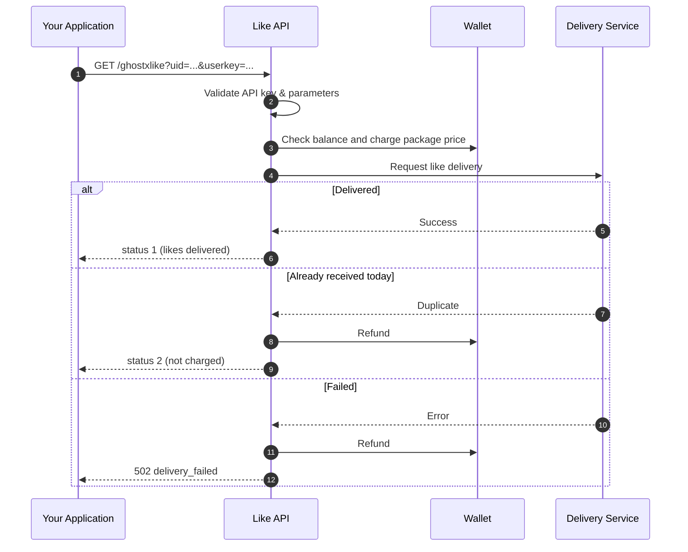

<div align="center">

# 🔥 GHOST X LIKES

### Like API — Programmatic Free Fire Like Delivery

Order Free Fire likes directly from your own code. Wallet billing, automatic refunds, and full order history, all through a single HTTP request.

<br>


<br>

[Overview](#-overview) •
[Quick Start](#-quick-start) •
[Endpoints](#-endpoints) •
[Parameters](#-parameters) •
[Responses](#-responses) •
[Errors](#-error-reference) •
[Examples](#-code-examples) •
[Security](#-security-best-practices)

</div>

---

## 📖 Overview

The Like API lets you place Free Fire like orders from any application, such as a bot, a backend service, or a script. Orders placed through the API behave exactly like orders placed on the website.

| Feature | Description |
|:--|:--|
| 💳 **Wallet billing** | Charged at the same price as the website |
| 🔄 **Automatic refunds** | Failed deliveries and duplicate daily orders are refunded instantly |
| 🧾 **Order history** | Every API order appears in **My Orders** with before/after like counts |
| 🌍 **Multi-region** | 14 supported server regions |
| 🛡️ **Rate limited** | 60 requests per minute per API key |

---

## ⚙️ How It Works



---

## 🚀 Quick Start

**1. Get your API key**
Open **Developer settings → Like API** on the website and select **Get API**.

**2. Fund your wallet**
Make sure your balance covers the package price.

**3. Send a request**

```bash
curl -s --max-time 120 \
  "https://www.fflikebd.site/ghostxlike?region=BD&uid=1234567890&userkey=YOUR_KEY"
```

> [!NOTE]
> API access must be enabled on your account. Otherwise requests return `403 no_permission`.

---

## 🌐 Base URL

```text
https://www.fflikebd.site/ghostxlike
```

All requests use the **GET** method.

---

## 🔌 Endpoints

### Default order

Orders the default package (**220 LIKE INSTANT · ৳6**).

```http
GET /ghostxlike?region=BD&uid={uid}&userkey=YOUR_KEY
```

### Order by package code

Select a package using the `pkgorder` parameter.

```http
GET /ghostxlike?region=BD&uid={uid}&pkgorder=200lk&userkey=YOUR_KEY
```

---

## 🧾 Parameters

| Name | Required | Type | Description |
|:--|:--:|:--:|:--|
| `uid` | ✅ | string | Free Fire player UID (5–15 digits) |
| `userkey` | ✅ | string | Your API key |
| `region` | — | string | Server region. Defaults to `BD` |
| `pkgorder` | — | string | Package code. Omit to use the default package |

### Supported regions

`BD` · `IND` · `SG` · `ID` · `TH` · `PK` · `ME` · `BR` · `SAC` · `NA` · `EU` · `VN` · `TW` · `RU`

---

## 📦 Package Codes

| `pkgorder` | Package | Likes | Price |
|:--:|:--|:--:|:--:|
| `200lk` *(default)* | 220 LIKE INSTANT | 220 | ৳6 |

> [!TIP]
> Package codes are case-insensitive, so `200LK` and `200lk` are equivalent. Prices match the website.

---

## 📬 Responses

### ✅ Success — `200` · `status: 1`

```json
{
  "status": 1,
  "message": "Likes delivered successfully.",
  "UID": "1234567890",
  "PlayerNickname": "PlayerName",
  "Region": "BD",
  "LikesBeforeCommand": 10250,
  "LikesAfterCommand": 10350,
  "LikesGivenByAPI": 100,
  "Package": "220 LIKE INSTANT",
  "pkgorder": "200lk",
  "OrderNo": "LK1A2B3C4D5E",
  "Charged": 6,
  "Balance": 84.5
}
```

| Field | Description |
|:--|:--|
| `LikesBeforeCommand` | Like count before the order |
| `LikesAfterCommand` | Like count after the order |
| `LikesGivenByAPI` | Likes delivered by this request |
| `OrderNo` | Order reference shown in **My Orders** |
| `Charged` | Amount deducted from your wallet |
| `Balance` | Remaining wallet balance |

### 🔁 Already received today — `200` · `status: 2`

The UID has already received its daily likes. **Nothing is charged**, as the amount is refunded automatically.

```json
{
  "status": 2,
  "message": "This UID has already received its likes today. You were not charged.",
  "UID": "1234567890",
  "Charged": 0,
  "Refunded": 6,
  "Balance": 90.5
}
```

### 💸 Insufficient balance — `402`

Nothing is charged. The response shows your balance and the amount required.

```json
{
  "status": 0,
  "error": "insufficient_balance",
  "message": "Insufficient balance.",
  "balance": 2.5,
  "required": 6,
  "short": 3.5
}
```

### ❌ Delivery failed — `502`

The amount is returned to your wallet automatically.

```json
{
  "status": 0,
  "error": "delivery_failed",
  "message": "Delivery failed. Your balance was refunded automatically.",
  "reason": "API HTTP 503",
  "Refunded": 6,
  "Balance": 90.5
}
```

---

## 🚨 Error Reference

| HTTP | `error` | Meaning |
|:--:|:--|:--|
| `400` | `invalid_uid` | `uid` must be a valid Free Fire UID (5–15 digits) |
| `400` | `invalid_pkgorder` | Unknown package code. The response includes an `available` list |
| `401` | `invalid_key` | Invalid or revoked API key |
| `402` | `insufficient_balance` | Wallet balance is lower than the package price |
| `403` | `no_permission` | API access is not enabled for your account |
| `409` | `order_in_progress` | An order for this request is still being processed |
| `429` | `rate_limited` | More than 60 requests per minute |
| `502` | `delivery_failed` | Delivery failed and the amount was refunded |

---

## 💻 Code Examples

> [!IMPORTANT]
> A request can take up to a minute. Set your client timeout to **90–120 seconds**.

<details open>
<summary><b>cURL</b></summary>

```bash
curl -s --max-time 120 \
  "https://www.fflikebd.site/ghostxlike?region=BD&uid=1234567890&pkgorder=200lk&userkey=YOUR_KEY"
```

</details>

<details>
<summary><b>PHP</b></summary>

```php
<?php
$url = "https://www.fflikebd.site/ghostxlike?" . http_build_query([
    "region"   => "BD",
    "uid"      => "1234567890",
    "pkgorder" => "200lk",
    "userkey"  => getenv("LIKE_API_KEY"),
]);

$ch = curl_init($url);
curl_setopt($ch, CURLOPT_RETURNTRANSFER, true);
curl_setopt($ch, CURLOPT_TIMEOUT, 120);
$response = curl_exec($ch);
curl_close($ch);

$data = json_decode($response, true);

switch ($data["status"] ?? 0) {
    case 1:  echo "Delivered: {$data['LikesGivenByAPI']} likes. Balance: {$data['Balance']}"; break;
    case 2:  echo "Already received today. Not charged."; break;
    default: echo "Error: " . ($data["message"] ?? "Unknown error");
}
```

</details>

<details>
<summary><b>Python</b></summary>

```python
import os
import requests

params = {
    "region": "BD",
    "uid": "1234567890",
    "pkgorder": "200lk",
    "userkey": os.environ["LIKE_API_KEY"],
}

resp = requests.get("https://www.fflikebd.site/ghostxlike", params=params, timeout=120)
data = resp.json()

if data.get("status") == 1:
    print(f"Delivered: {data['LikesGivenByAPI']} likes. Balance: {data['Balance']}")
elif data.get("status") == 2:
    print("Already received today. Not charged.")
else:
    print("Error:", data.get("message"))
```

</details>

<details>
<summary><b>Node.js</b></summary>

```javascript
const params = new URLSearchParams({
  region: "BD",
  uid: "1234567890",
  pkgorder: "200lk",
  userkey: process.env.LIKE_API_KEY,
});

const res = await fetch(`https://www.fflikebd.site/ghostxlike?${params}`, {
  signal: AbortSignal.timeout(120_000),
});
const data = await res.json();

if (data.status === 1) {
  console.log(`Delivered: ${data.LikesGivenByAPI} likes. Balance: ${data.Balance}`);
} else if (data.status === 2) {
  console.log("Already received today. Not charged.");
} else {
  console.log("Error:", data.message);
}
```

</details>

---

## 📌 Good to Know

- ⏳ Requests may take up to **one minute** to complete.
- 💰 Each successful request charges the package price to your wallet.
- 🔄 Failed deliveries are **refunded automatically**.
- 📅 A UID can receive likes **once per day**. A second attempt returns `status: 2` at no cost.
- 🧾 Every API order is listed in **My Orders** with before/after like counts.
- 🚦 Limit: **60 requests per minute** per API key.

---

## 🔐 Security Best Practices

> [!WARNING]
> Never commit your API key to a public repository or share it with anyone.

- Store the key in an **environment variable** or secret manager, not in source code.
- If a key is exposed, **revoke it immediately** in **Get API** and generate a new one.
- Avoid logging full request URLs, since they contain your key in the query string.

```bash
export LIKE_API_KEY="your_real_key"
curl -s "https://www.fflikebd.site/ghostxlike?uid=1234567890&userkey=$LIKE_API_KEY"
```

---

## 🛟 Support

Need help? Use **Live Chat** on the website or message us on **Telegram**.

<div align="center">

<sub>© GHOST X LIKES · All rights reserved</sub>

</div>
